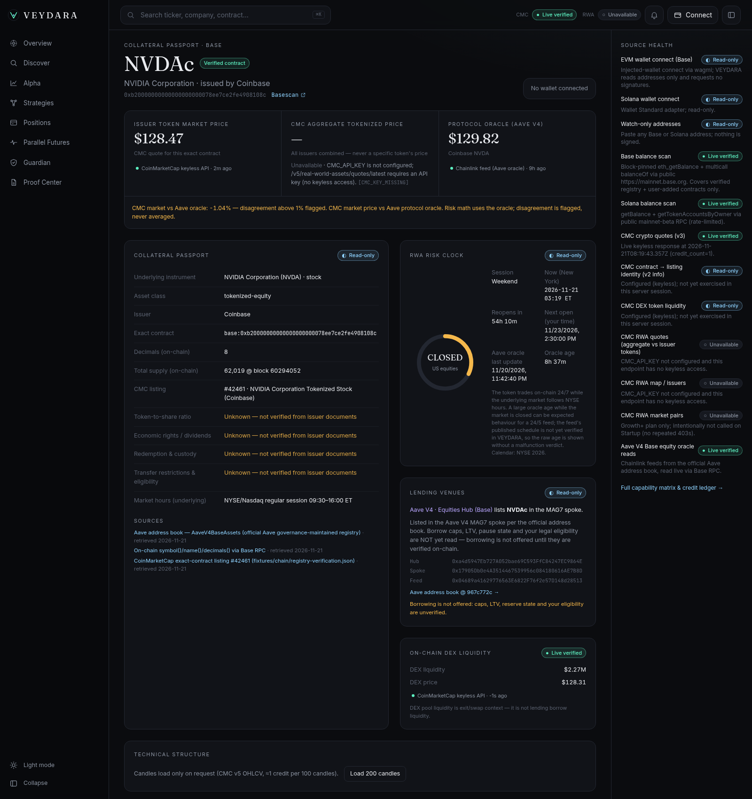
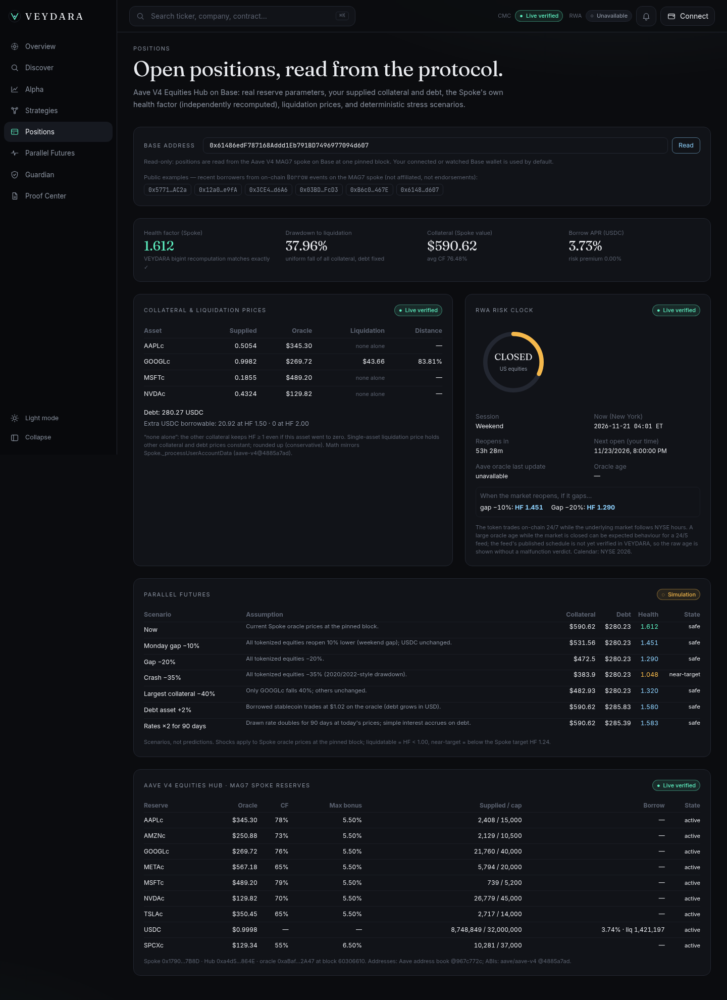
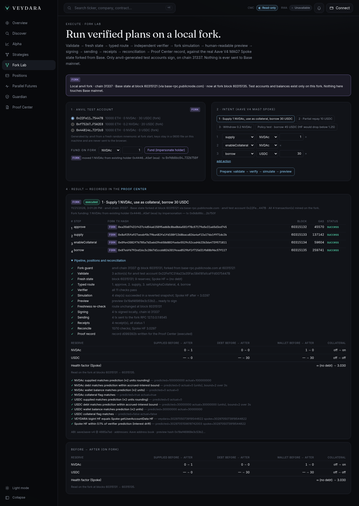

# VEYDARA — Crypto & RWA Capital Operating System

> Understands what you actually own, explains the exact instrument and its real risks, and shows every number's source.

Built for the **CoinMarketCap API Hackathon, Round 2 — Real World Assets track** (submissions close 9 Dec 2026, 23:59 UTC).







## What works today (verified 2026-11-21)

| | |
|---|---|
| **Holdings-first wallet scan** | Connect a Base wallet (injected) or Solana wallet, or watch any address. Base: block-pinned native + verified-registry balances via one multicall. Solana: SOL + all SPL/Token-2022 accounts. |
| **Exact token identity** | Coinbase tokenized equities on Base pinned to the official Aave address book, cross-checked on-chain and against CMC's exact-contract listing. Unknown tokens quarantined; ticker collisions/homoglyphs flagged. |
| **Collateral Passport** | Underlying vs issuer token, on-chain supply, CMC listing, three distinct prices (CMC token quote, CMC RWA aggregate, Aave V4 oracle) with a disagreement flag, live Aave V4 reserve facts (CF, caps, bonus), DEX liquidity, explicit unknowns, sources. |
| **Charts + Alpha** | Real CMC DEX K-line candles (1h/4h/1d/1w) for any token contract, EMA20/50 and clustered support/resistance zones, RSI/MACD/ATR, table view, outlier-wick disclosure; multi-horizon research (1h/4h/1d) with per-horizon sources. |
| **Aave V4 Equities Hub** | Live reserves and user positions on Base; VEYDARA's bigint health factor equals the Spoke's `getUserAccountData` exactly; liquidation prices, drawdown-to-liquidation, borrow APR, headroom. |
| **RWA Risk Clock** | NYSE session (DST/holiday-aware), next open in local time, oracle age, and what a re-open gap does to the live position's HF. |
| **Parallel Futures** | Deterministic scenarios (gaps, crash, single-name collapse, debt +2%, rates ×2) on live state — labeled simulation. |
| **Solver Arena** | Four solvers propose USDC borrow plans; an independent rational-arithmetic verifier checks caps, liquidity, reserve state, balances and an HF ≥ 1.25 policy. Nothing executes. |
| **Fork Lab (Phase 4)** | Supply → use as collateral → borrow USDC → partial repay → withdraw against the real Aave V4 MAG7 Spoke state on a **local anvil fork of Base (chain 31337)**. Pipeline: validate → fork guard → fresh state → typed route (pinned ABI, exact-amount approvals) → independent verifier → simulation in a reverted snapshot → human-readable preview (hash-bound) → local signing with an anvil-generated key → send to the fork → receipts with decoded reverts → reconciliation (VEYDARA HF = Spoke HF) → Proof Center record. Blocked and reverted runs are recorded too. |
| **Guardian** | 7-axis risk radar per watched position; in-app alert center with monitor-only policies (de-duplicated inbox, bell badge); emergency center showing positions, live token allowances (address-book spenders + Approval-log discovery) and position managers, with revocations prepared and simulated **only on the fork**. |
| **Capital Constellation** | Holdings → underlying → venues → live Aave position graph, with a table fallback. |
| **CMC gateway + Proof Center** | Zod schemas, TTL cache, single-flight, negative caching, backoff, circuit breaker, expired-plan detection with keyless fallback, credit ledger (expected vs reported), recorded key-access probe. |

**CMC key status (2026-11-21):** the project key answers `/v1/key/info` (450,000 credits/month, 600 req/min) but all data endpoints return **HTTP 402 / 1004 "subscription plan has expired"**. RWA quotes, the issuer graph and CEX-aggregated v5 OHLCV therefore show *Unavailable* with that reason; everything keyless-capable falls back to the public API automatically. See [docs/SOURCES-AND-CLAIMS.md §3a](docs/SOURCES-AND-CLAIMS.md).

Not built yet: free-form intents, mainnet execution (deliberately absent), push/email alert channels, Kamino/Morpho/Lista adapters. See [docs/PRODUCT-FEATURE-MATRIX.md](docs/PRODUCT-FEATURE-MATRIX.md).

## CMC endpoints used
- `/v3/cryptocurrency/quotes/latest` — holdings and asset quotes
- `/v2/cryptocurrency/info?address=` — exact-contract → CMC listing identity
- `/v1/dex/token` — DEX liquidity context
- `/v1/k-line/candles` — DEX OHLCV for charts, indicators, zones, research
- `/v5/real-world-assets/quotes/latest` — aggregate tokenized price, issuer tokens, issuer graph (key)
- `/v5/real-world-assets/map` — RWA search and 0-credit access probe (key)
- `/v5/cryptocurrency/ohlcv/historical` — CEX-aggregated candles (key)
- `/v1/key/info` — plan/credit status (0 credits)
- Schemas also cover `/v5/real-world-assets/info`, `/quotes/historical`, `/issuers/list`, `/issuers`, `/v1/dex/token/pools`.

Evidence of real calls: `fixtures/cmc/*.live.json`, `fixtures/chain/*.live.json`, and the in-app ledger at `/proof`.

## Run locally
```bash
pnpm install --frozen-lockfile
cp .env.example apps/web/.env.local   # optional: add CMC_API_KEY, BASE_RPC_URL
pnpm check:env
pnpm dev                               # http://localhost:3000
```
Try it without a wallet: `http://localhost:3000/?watch=0xa4d5947Eb727A052bae69C593FfC84247EC9864E` (the Aave V4 Equities Hub contract — a real protocol contract holding tokenized equities, not a personal wallet). On `/positions`, `/strategies` and `/futures`, the address bar offers recent public borrowers found in on-chain `Borrow` events.

```bash
pnpm lint && pnpm typecheck && pnpm test && pnpm build   # what CI runs
pnpm test:live          # opt-in live reads (Base RPC, Aave feed, CMC keyless)
pnpm verify:registry    # re-verify registry contracts on-chain + on CMC
pnpm probe:cmc          # re-probe which CMC endpoints the configured key can access (0 credits on 402)
pnpm record:aave        # re-record Aave V4 market/positions and cross-check HF math against the Spoke
pnpm e2e                # Playwright: wallet → analysis → risk → simulation → proof on the fixture dataset
```

### Fork Lab (local only)
```bash
curl -L https://foundry.paradigm.xyz | bash && foundryup   # anvil
pnpm fork               # anvil --fork-url <public Base RPC> --chain-id 31337 on 127.0.0.1:8545, random anvil accounts
pnpm start              # open /fork
pnpm record:fork        # scripted lifecycle + blocked + revert drill → fixtures/fork/*.fork.json
```
The signer refuses any RPC that is not loopback, any chain id other than 31337, and any account that anvil did not generate. Fork test keys stay in a 0600 file under `/tmp/veydara-fork/` (never printed, never committed). Fork tx hashes exist only on the local fork.

## Supported chains
Base (8453) — scan, identity, Aave V4 reserves/positions/oracle. Solana mainnet — scan, identity. Ethereum/BNB: architecture only.

## Docs
[Architecture](docs/ARCHITECTURE.md) · [Feature matrix](docs/PRODUCT-FEATURE-MATRIX.md) · [CMC credit strategy](docs/CMC-API-CREDIT-STRATEGY.md) · [Sources & claims](docs/SOURCES-AND-CLAIMS.md) · [Issuer eligibility](docs/ISSUER-ELIGIBILITY.md) · [Protocol adapters](docs/PROTOCOL-ADAPTERS.md) · [Financial models](docs/FINANCIAL-MODELS.md) · [Security](docs/SECURITY.md) · [Execution runbook](docs/EXECUTION-RUNBOOK.md) · [Demo script](docs/DEMO-SCRIPT.md)

## Disclaimer
VEYDARA is research software. It is not investment, legal or tax advice, does not recommend buying, selling or borrowing, and in this release cannot sign or send transactions. Tokenized securities are subject to issuer- and jurisdiction-specific eligibility rules that VEYDARA has not verified for you.

MIT licensed.
